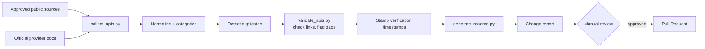
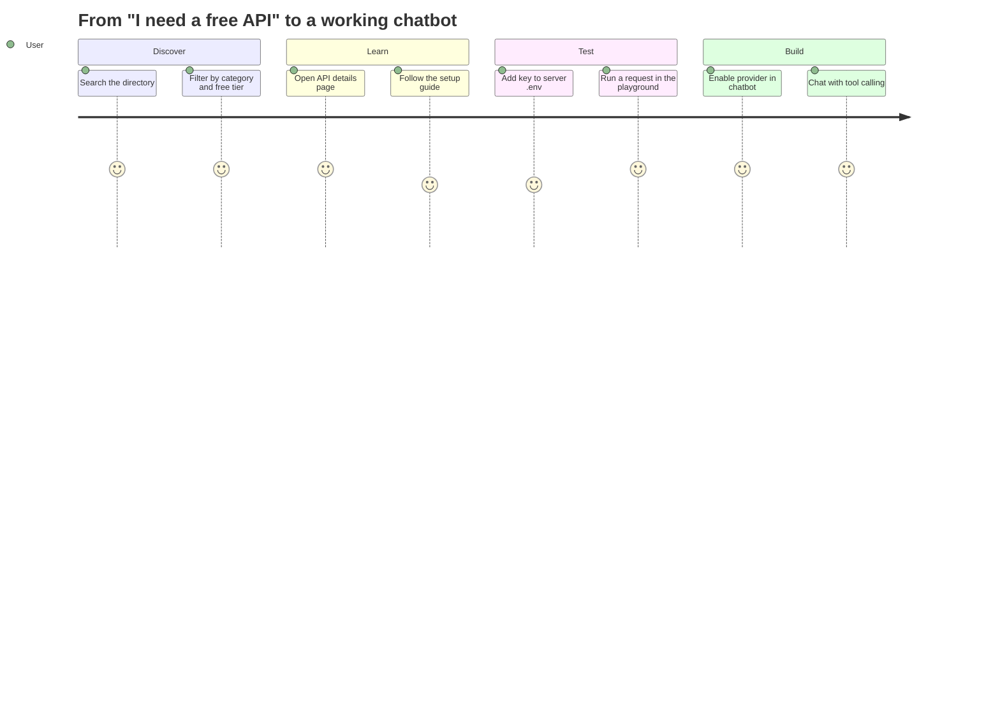
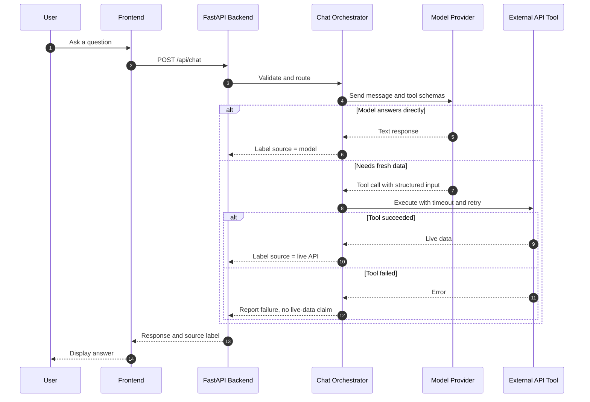
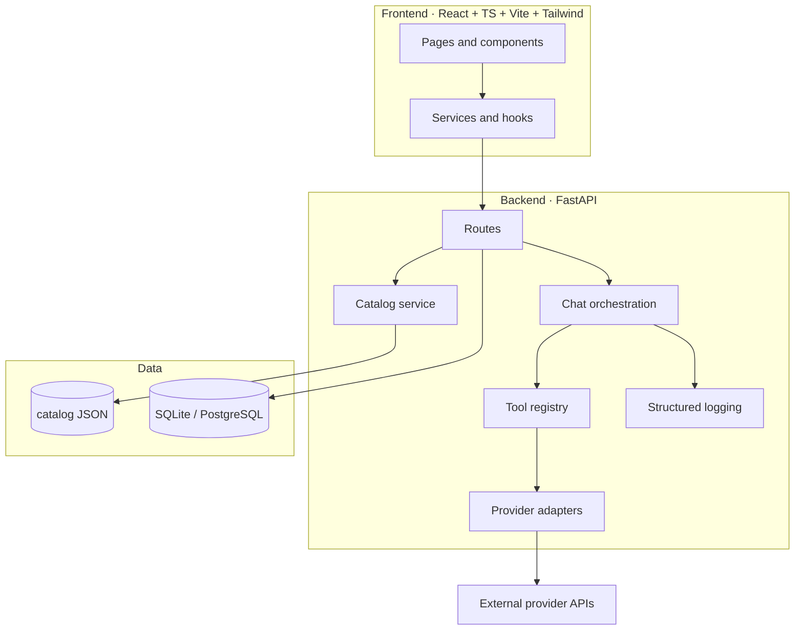
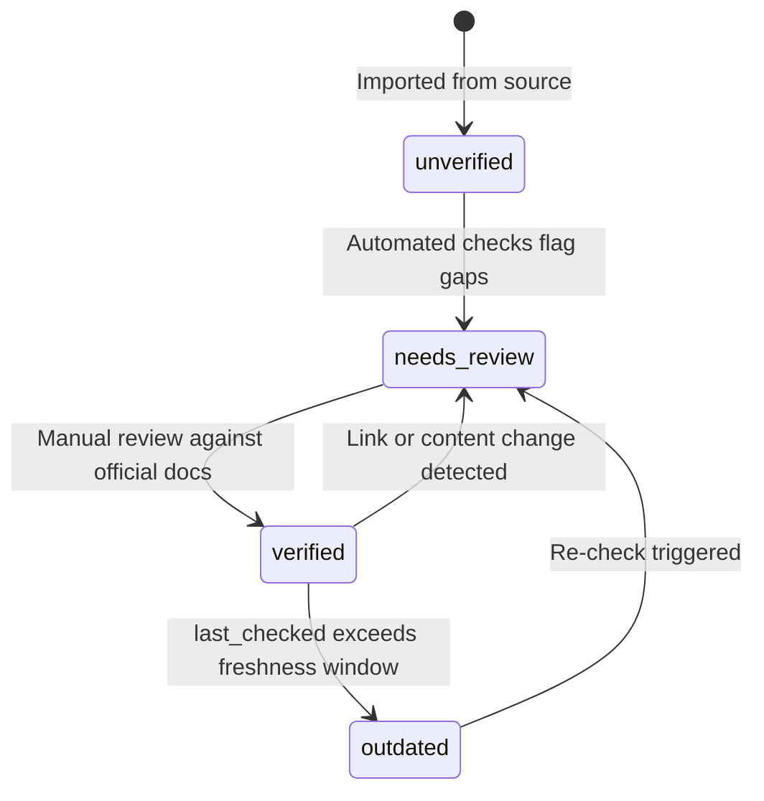
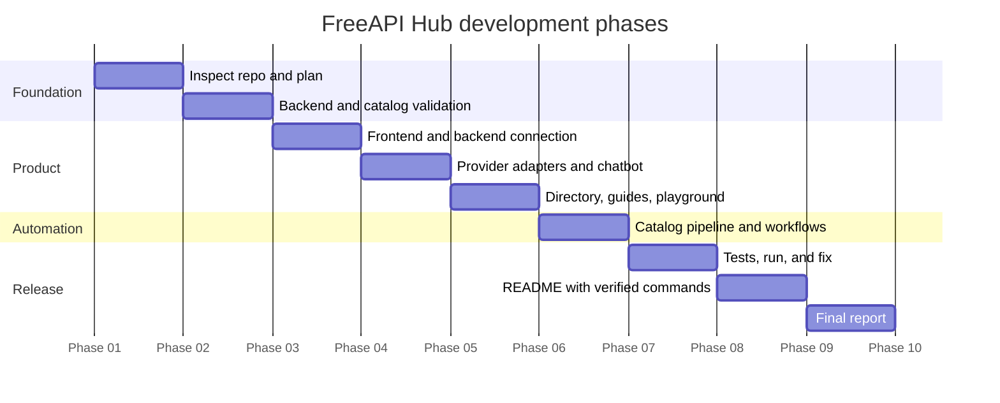

<div align="center">


<a href="https://github.com/YOUR_USERNAME/freeapi-hub">
  
</a>

<br/><br/>


<br/>


<br/>


<br/>


<br/>

**[Overview](#-overview) · [Features](#-core-features) · [How It Works](#-how-it-works) · [Quick Start](#-quick-start) · [Catalog](#-api-catalog-data-model) · [Backend API](#-backend-api-reference) · [Chatbot](#-ai-automation-chatbot) · [Security](#-security) · [Roadmap](#-roadmap) · [FAQ](#-faq)**


</div>

## 📑 Table of Contents

| #  | Section                                                         | #  | Section                                                   |
|:--:|:----------------------------------------------------------------|:--:|:----------------------------------------------------------|
| 1  | [Overview](#-overview)                                          | 12 | [Security](#-security)                                    |
| 2  | [Who It Is For](#-who-it-is-for)                                | 13 | [Testing](#-testing)                                      |
| 3  | [Core Features](#-core-features)                                | 14 | [GitHub Workflows](#-github-actions-workflows)            |
| 4  | [How It Works](#-how-it-works)                                  | 15 | [Deployment](#-deployment)                                |
| 5  | [Architecture](#-architecture)                                  | 16 | [Troubleshooting](#-troubleshooting)                      |
| 6  | [Technology Stack](#-technology-stack)                          | 17 | [Roadmap](#-roadmap)                                      |
| 7  | [User Interface](#-user-interface)                              | 18 | [Contributing](#-contributing)                            |
| 8  | [API Catalog Data Model](#-api-catalog-data-model)              | 19 | [FAQ](#-faq)                                              |
| 9  | [Repository Structure](#-repository-structure)                  | 20 | [Known Limitations](#-known-limitations)                  |
| 10 | [Quick Start](#-quick-start)                                    | 21 | [Glossary](#-glossary)                                    |
| 11 | [Backend API Reference](#-backend-api-reference)                | 22 | [Publish to GitHub](#-publish-to-github)                  |

---

## 📖 Overview

**FreeAPI Hub** is a centralized platform for **discovering free API services**, **learning how to obtain API keys**, **testing supported APIs**, and **integrating multiple providers into an AI automation chatbot**.

| 🎯 Goal                     | 💡 How FreeAPI Hub delivers it                                        |
|:----------------------------|:----------------------------------------------------------------------|
| Find free APIs quickly      | Searchable, filterable catalog across 17 categories                   |
| Get a key without guessing  | Per-API step-by-step setup guides                                     |
| Prove an API works          | Live testing playground with real status, latency, and responses      |
| Build AI agents fast        | Multi-provider chatbot with tool calling and fallback                 |
| Keep data trustworthy       | Automated validation, verification timestamps, manual review          |

> [!IMPORTANT]
> **Accuracy first.** FreeAPI Hub never invents free plans, quotas, pricing, or working status. Anything not verified from official documentation is shown as `unknown` or `unverified`, and every record carries a `last_checked` date.

---

## 👥 Who It Is For

| Audience             | What they get                                                              |
|:---------------------|:---------------------------------------------------------------------------|
| 🎓 **Students**       | Free ways to learn APIs and AI without a budget                            |
| 👨‍💻 **Developers**     | A vetted directory plus working integration examples                       |
| 🔬 **Researchers**    | Public datasets, search, NLP, and translation services in one place        |
| 🤖 **AI engineers**   | Provider adapters, tool registry, and chatbot orchestration to build on    |

---

## ✨ Core Features

| # | Module                       | What it does                                                               | Status |
|:-:|:-----------------------------|:---------------------------------------------------------------------------|:------:|
| A | 📚 **Free API Directory**     | Searchable, filterable catalog with verification status and quotas         |   🚧   |
| B | 🧭 **API Setup Guides**       | Per-API walkthrough from signup to a working chatbot integration           |   🚧   |
| C | 🤖 **AI Automation Chatbot**  | Multi-provider chat with tool selection, retries, fallback, usage tracking |   🚧   |
| D | 🧪 **Testing Playground**     | Run real test requests; see status, latency, response, quota details       |   🚧   |
| E | 🔄 **Automated Updates**      | Python pipeline that collects, validates, and regenerates the catalog      |   🚧   |

> Status legend: ✅ done · 🚧 in progress · ⏳ planned. Update this table as modules ship.

<details>
<summary><b>📚 A · Free API Directory (click to expand)</b></summary>

<br/>

**17 categories**

| Group                     | Categories                                                                                       |
|:--------------------------|:-------------------------------------------------------------------------------------------------|
| 🧠 AI & Automation         | AI and LLM providers · AI agents and automation · Embeddings and vector databases                |
| 🔎 Information             | Web search and research · News and information · Public datasets · Education and research        |
| 🎨 Media & Language        | Image generation and analysis · Speech-to-text / text-to-speech · Translation and NLP            |
| 🌍 Data & Location         | Weather and climate · Finance and market data · Maps and geolocation                             |
| 🛠️ Infrastructure          | Developer tools · Cloud and serverless platforms · Database services · Email and communication   |

**Fields displayed for every API**

| Identity            | Access                      | Limits & Terms               | Trust                |
|:--------------------|:----------------------------|:-----------------------------|:---------------------|
| Name and provider   | Official website            | Free-tier status             | Last verified date   |
| Description         | Official documentation      | Documented quotas            | Verification status  |
| Use cases           | API key registration link   | Rate limits                  | Source URLs          |
| SDKs and languages  | Authentication method       | Credit card requirement      |                      |
|                     |                             | Commercial-use restrictions  |                      |

**Directory controls**

| Control          | Behavior                                                         |
|:-----------------|:-----------------------------------------------------------------|
| 🔍 Search         | Full-text across name, provider, description, use cases          |
| 🗂️ Category filter| One or many of the 17 categories                                 |
| 🆓 Free-tier filter| Free · free tier · limited credits · temporary trial · unknown  |
| ↕️ Sorting        | Name, category, last verified, verification status               |
| 📄 Pagination     | Server-side pages with total count                               |
| ⭐ Favorites       | Save APIs for quick access                                       |

</details>

<details>
<summary><b>🧭 B · API Setup Guide (click to expand)</b></summary>

<br/>

Each API gets a dedicated details page with these ten steps:

| Step | Content                                   | Step | Content                                  |
|:----:|:------------------------------------------|:----:|:-----------------------------------------|
|  1   | Official registration link                |  6   | Required dependency installation         |
|  2   | Account creation instructions             |  7   | Minimal working integration example      |
|  3   | API dashboard navigation                  |  8   | Request execution and response handling  |
|  4   | API key creation instructions             |  9   | Rate-limit and error handling            |
|  5   | Environment variable configuration        |  10  | Chatbot integration example              |

Screenshots appear **only** when genuine ones are available; otherwise clear text instructions are used.

</details>

<details>
<summary><b>🤖 C · AI Automation Chatbot (click to expand)</b></summary>

<br/>

| Capability                        | Description                                                                 |
|:----------------------------------|:----------------------------------------------------------------------------|
| 💬 Chat interface & history        | Persistent conversation history                                             |
| 🔀 Provider switching              | Configurable provider and model, plus a **fallback provider**               |
| 🧰 Tool & API registry             | Tools chosen from user intent, with **structured inputs**                   |
| 🔁 Resilience                      | Retry, timeout, and rate-limit handling                                     |
| 📊 Usage tracking                  | Where the provider supports it                                              |
| 🪵 Safe logging                    | Structured logs with credentials redacted                                   |
| ✅ Honest answers                  | Separates **model knowledge** from **fresh API data**; never claims live data unless the tool call succeeded |

</details>

<details>
<summary><b>🧪 D · API Testing Playground (click to expand)</b></summary>

<br/>

| Input / Control        | Output / Display                          |
|:-----------------------|:------------------------------------------|
| Provider selection     | HTTP status                               |
| Configuration status   | Execution time                            |
| Request parameters     | Response viewer                           |
| Test request button    | Error messages                            |
| Loading indicator      | Usage or quota details (when available)   |

> [!NOTE]
> Secret keys are **never** exposed in frontend code, URLs, browser logs, or API responses. Playground results are real responses only, never mocks presented as live.

</details>

<details>
<summary><b>🔄 E · Automated Catalog Updates (click to expand)</b></summary>

<br/>



| Pipeline step          | Script               | Output                                      |
|:-----------------------|:---------------------|:--------------------------------------------|
| Import and normalize   | `collect_apis.py`    | Cleaned, categorized records                |
| Validate and flag      | `validate_apis.py`   | Schema errors, dead links, stale entries    |
| Regenerate docs        | `generate_readme.py` | Updated catalog tables and README sections  |
| Report                 | all                  | Human-readable change report                |

A successful website request is **not** treated as proof an API works. Manual review covers anything automation cannot verify.

</details>

---

## 🔍 How It Works

### End-to-end user journey



### Chatbot request lifecycle



### Live data vs. model knowledge

| Situation                          | Label shown to user         | Claim allowed                                  |
|:-----------------------------------|:----------------------------|:-----------------------------------------------|
| Model answered from training data  | 🧠 **Model knowledge**       | May be outdated                                |
| Tool call succeeded                | 🌐 **Live API data**         | Fresh data from the named API                  |
| Tool call failed or timed out      | ⚠️ **Tool unavailable**      | **No** live-data claim; error explained        |
| Provider key missing               | 🔑 **Not configured**        | Helpful setup message, no fake response        |

---

## 🏗️ Architecture



| Module                  | Responsibility                                                   |
|:------------------------|:-----------------------------------------------------------------|
| Frontend presentation   | Pages, components, theming, accessibility                        |
| Backend routes          | HTTP API, validation, rate limiting                              |
| Provider adapters       | Provider-specific request formats behind a **common interface**  |
| API tool registry       | Registered tools, schemas, intent-based selection                |
| Chat orchestration      | Routing, retries, fallback, live-vs-model distinction            |
| Catalog services        | Load, search, filter, and serve catalog data                     |
| Auth & configuration    | Server-side env config for enabled providers and models          |
| Database access         | Favorites, history, settings persistence                         |
| Logging                 | Structured, secret-redacted logs                                 |
| Automated validation    | Schema, duplicates, link checks, staleness flags                 |
| Tests                   | Pytest, Vitest, React Testing Library                            |

### Provider adapter interface (design)

Provider-specific request formats stay **inside adapters**. The rest of the app talks only to the common interface.

```python
# backend/app/providers/base.py  (design sketch)
from abc import ABC, abstractmethod
from pydantic import BaseModel

class ChatMessage(BaseModel):
    role: str          # "system" | "user" | "assistant" | "tool"
    content: str

class ChatResult(BaseModel):
    text: str
    model: str
    usage: dict | None = None   # only if the provider reports it

class ProviderAdapter(ABC):
    name: str

    @abstractmethod
    def is_configured(self) -> bool: ...

    @abstractmethod
    async def chat(self, messages: list[ChatMessage], model: str) -> ChatResult: ...
```

| Adapter rule                          | Why                                                   |
|:--------------------------------------|:------------------------------------------------------|
| One adapter per provider              | Isolates provider-specific payloads                   |
| Models come from configuration        | No hard-coded model names across the app              |
| `is_configured()` checks server env   | Missing key yields a clear error, never a fake result |
| Usage returned only when reported     | No estimated numbers presented as real                |

---

## 🧰 Technology Stack

| Layer          | Technologies                                                      | Why                                      |
|:---------------|:------------------------------------------------------------------|:-----------------------------------------|
| **Frontend**   | React · TypeScript · Vite · Tailwind CSS · accessible components  | Fast, typed, responsive UI               |
| **Backend**    | Python · FastAPI · Pydantic · HTTPX · structured logging          | Async APIs with strict validation        |
| **Data**       | JSON catalog · SQLite (local) · PostgreSQL (optional production)  | Simple start, scalable later             |
| **Testing**    | Pytest · HTTPX test client · Vitest · React Testing Library       | Full-stack coverage                      |
| **Automation** | GitHub Actions · Python scripts · scheduled validation · auto PRs | Reviewed, repeatable catalog updates     |

---

## 🎨 User Interface

| Aspect        | Details                                                                                  |
|:--------------|:-----------------------------------------------------------------------------------------|
| **Palette**   | Midnight blue · rich navy · dark indigo · soft black · electric cyan · violet highlights |
| **Themes**    | Light and dark                                                                           |
| **Layout**    | Responsive, consistent spacing, subtle borders, clear hierarchy                          |
| **Behaviors** | Search · category and free-tier filters · sorting · pagination                           |
| **States**    | Empty, loading, and error states on every data view                                      |

### Color system

| Role            | Color                  | Hex        |
|:----------------|:-----------------------|:-----------|
| Background      | Soft black             | `#0B1020`  |
| Surface         | Rich navy              | `#111936`  |
| Elevated        | Dark indigo            | `#1B1F5E`  |
| Primary accent  | Electric cyan          | `#00E5FF`  |
| Secondary accent| Violet                 | `#7C3AED`  |

### Pages

| Page                | Page                      | Page                    |
|:--------------------|:--------------------------|:------------------------|
| 🏠 Home dashboard    | 📖 API details             | 🧪 Testing playground    |
| 📚 API directory     | 🧭 Step-by-step guide      | 📘 Documentation         |
| 🗂️ Category explorer | 🤖 Chatbot                 | ⭐ Favorites             |
|                     |                           | ⚙️ Project settings      |

---

## 🗃️ API Catalog Data Model

| Field                  | Purpose                                                                      |
|:-----------------------|:-----------------------------------------------------------------------------|
| `id`                   | Unique identifier                                                            |
| `name` · `provider`    | Display name and owning provider                                             |
| `category`             | Category from `categories.json`                                              |
| `description`          | What the API does                                                            |
| `website_url`          | Official website                                                             |
| `documentation_url`    | Official docs                                                                |
| `signup_url`           | API key registration                                                         |
| `pricing_url`          | Official pricing page                                                        |
| `access_type`          | `free` · `free_tier` · `limited_credits` · `temporary_trial` · `unknown`     |
| `free_tier_details`    | Verified free-tier description, or `unknown`                                 |
| `rate_limits`          | Documented limits, or `unknown`                                              |
| `credit_card_required` | `true` · `false` · `unknown`                                                 |
| `authentication_type`  | API key, OAuth, none, etc.                                                   |
| `supported_languages`  | SDK languages                                                                |
| `commercial_use`       | Documented restrictions, or `unknown`                                        |
| `verification_status`  | `verified` · `unverified` · `needs_review` · `outdated`                      |
| `last_checked`         | ISO date of last verification                                                |
| `source_urls`          | Sources backing each claim                                                   |

### Access type definitions

| Type               | Meaning                                                          |
|:-------------------|:-----------------------------------------------------------------|
| `free`             | Fully free service                                               |
| `free_tier`        | Ongoing free plan with limits, paid above them                   |
| `limited_credits`  | One-time or recurring credits that run out                       |
| `temporary_trial`  | Time-limited trial                                               |
| `unknown`          | Not yet verified; no claim is made                               |

### Verification status lifecycle



### Example record (illustrative structure only)

```json
{
  "id": "example-provider-chat",
  "name": "Example Chat API",
  "provider": "Example Provider",
  "category": "ai-and-llm",
  "description": "Placeholder showing the schema shape.",
  "website_url": "https://example.com",
  "documentation_url": "https://example.com/docs",
  "signup_url": "https://example.com/signup",
  "pricing_url": "https://example.com/pricing",
  "access_type": "unknown",
  "free_tier_details": "unknown",
  "rate_limits": "unknown",
  "credit_card_required": "unknown",
  "authentication_type": "api_key",
  "supported_languages": ["python", "javascript"],
  "commercial_use": "unknown",
  "verification_status": "unverified",
  "last_checked": null,
  "source_urls": []
}
```

> [!NOTE]
> The record above is a **schema illustration**, not a real listing. Real entries are added only with official source URLs.

### Candidate providers (to be verified, not yet confirmed)

| Provider        | Category           | Verification status |
|:----------------|:-------------------|:-------------------:|
| Gemini          | AI and LLM         | ⏳ Pending           |
| Groq            | AI and LLM         | ⏳ Pending           |
| Hugging Face    | AI and LLM         | ⏳ Pending           |
| OpenRouter      | AI and LLM         | ⏳ Pending           |

> [!WARNING]
> Free-tier conditions change often. Check each provider's official pricing page before relying on any quota.

---

## 📁 Repository Structure

```text
freeapi-hub/
├── frontend/
│   └── src/
│       ├── components/      # Reusable UI building blocks
│       ├── pages/           # Route-level pages
│       ├── services/        # Backend API client
│       ├── hooks/           # Shared React hooks
│       └── types/           # TypeScript types
├── backend/
│   ├── app/
│   │   ├── api/             # Route handlers
│   │   ├── core/            # Config, security, logging
│   │   ├── models/          # Database models
│   │   ├── schemas/         # Pydantic schemas
│   │   ├── providers/       # Provider adapters
│   │   ├── services/        # Catalog, chat orchestration
│   │   └── tools/           # Tool registry and tools
│   └── tests/
├── catalog/
│   ├── apis.json            # Catalog records
│   └── categories.json      # Category definitions
├── scripts/
│   ├── collect_apis.py
│   ├── validate_apis.py
│   └── generate_readme.py
├── docs/
│   ├── architecture.md
│   ├── api-setup-guides.md
│   ├── chatbot-guide.md
│   ├── deployment.md
│   └── security.md
├── examples/
│   ├── python/
│   └── javascript/
├── .github/workflows/
│   ├── test.yml
│   └── catalog-update.yml
├── README.md
├── CONTRIBUTING.md
├── SECURITY.md
├── LICENSE
├── .gitignore
└── .env.example
```

| Folder       | Purpose                                                  |
|:-------------|:---------------------------------------------------------|
| `frontend/`  | React + TypeScript dashboard                             |
| `backend/`   | FastAPI server, adapters, tools, tests                   |
| `catalog/`   | Source-of-truth JSON data                                |
| `scripts/`   | Collection, validation, and generation automation        |
| `docs/`      | In-depth documentation                                   |
| `examples/`  | Copy-paste integration examples                          |
| `.github/`   | CI and scheduled catalog workflows                       |

---

## ✅ Prerequisites

| Tool    | Minimum version | Check command         |
|:--------|:----------------|:----------------------|
| Python  | 3.11+           | `python --version`    |
| Node.js | 18+             | `node --version`      |
| npm     | 9+              | `npm --version`       |
| Git     | 2.x             | `git --version`       |

---

## 🚀 Quick Start

### 1 · Clone

```bash
git clone https://github.com/YOUR_USERNAME/freeapi-hub.git
cd freeapi-hub
```

### 2 · Environment setup

| Platform             | Command                          |
|:---------------------|:---------------------------------|
| Windows PowerShell   | `Copy-Item .env.example .env`    |
| Linux / macOS        | `cp .env.example .env`           |

Then edit `.env` and add **your own** keys. Never commit this file.

### 3 · Backend

| Step            | Windows PowerShell                                   | Linux / macOS                                  |
|:----------------|:-----------------------------------------------------|:-----------------------------------------------|
| Enter folder    | `cd backend`                                         | `cd backend`                                   |
| Create venv     | `python -m venv .venv`                               | `python3 -m venv .venv`                        |
| Activate        | `.\.venv\Scripts\Activate.ps1`                       | `source .venv/bin/activate`                    |
| Install         | `pip install -r requirements.txt`                    | `pip install -r requirements.txt`              |
| Run             | `uvicorn app.main:app --reload --port 8000`          | `uvicorn app.main:app --reload --port 8000`    |

> [!TIP]
> On Windows, if script activation is blocked, run `Set-ExecutionPolicy -Scope Process -ExecutionPolicy RemoteSigned` in the same PowerShell window first.

### 4 · Frontend

```bash
cd frontend
npm install
npm run dev
```

### 5 · Open the app

| Service      | URL                           |
|:-------------|:------------------------------|
| Frontend     | http://localhost:5173         |
| Backend API  | http://localhost:8000         |
| Swagger docs | http://localhost:8000/docs    |

---

## 🔐 Environment Variables

| Variable                  | Required | Description                               |
|:--------------------------|:--------:|:------------------------------------------|
| `DEFAULT_PROVIDER`        |   Yes    | Provider used by the chatbot by default   |
| `FALLBACK_PROVIDER`       |    No    | Provider used when the primary fails      |
| `GEMINI_API_KEY`          |    No    | Google Gemini key (if enabled)            |
| `GROQ_API_KEY`            |    No    | Groq key (if enabled)                     |
| `HUGGINGFACE_API_KEY`     |    No    | Hugging Face key (if enabled)             |
| `OPENROUTER_API_KEY`      |    No    | OpenRouter key (if enabled)               |
| `DATABASE_URL`            |    No    | SQLite default; PostgreSQL for production |
| `REQUEST_TIMEOUT_SECONDS` |    No    | Outbound request timeout                  |
| `MAX_RESPONSE_BYTES`      |    No    | Response-size cap for outbound calls      |
| `RATE_LIMIT_PER_MINUTE`   |    No    | Limit for sensitive endpoints             |

### `.env.example`

```dotenv
DEFAULT_PROVIDER=
FALLBACK_PROVIDER=

GEMINI_API_KEY=your_key_here
GROQ_API_KEY=your_key_here
HUGGINGFACE_API_KEY=your_key_here
OPENROUTER_API_KEY=your_key_here

DATABASE_URL=sqlite:///./freeapi_hub.db
REQUEST_TIMEOUT_SECONDS=20
MAX_RESPONSE_BYTES=1000000
RATE_LIMIT_PER_MINUTE=30
```

> Keep real values only in `.env`. The committed `.env.example` contains placeholders.

---

## 🔗 API Registration Links

Use **official** pages only. Links are filled in as each entry is verified.

| Provider        | Signup / API key page          | Docs                         | Verified |
|:----------------|:-------------------------------|:-----------------------------|:--------:|
| Gemini          | _added after verification_     | _added after verification_   |    ⏳    |
| Groq            | _added after verification_     | _added after verification_   |    ⏳    |
| Hugging Face    | _added after verification_     | _added after verification_   |    ⏳    |
| OpenRouter      | _added after verification_     | _added after verification_   |    ⏳    |

Detailed tutorials: [`docs/api-setup-guides.md`](docs/api-setup-guides.md)

### Universal setup pattern

| Step | Action                                                    | You do it in                  |
|:----:|:----------------------------------------------------------|:------------------------------|
|  1   | Open the provider's **official** signup page              | Browser                       |
|  2   | Create an account and verify your email                   | Provider site                 |
|  3   | Find the API keys section of the dashboard                | Provider dashboard            |
|  4   | Create a key and copy it once                             | Provider dashboard            |
|  5   | Paste it into `.env` under the matching variable          | Local `.env`                  |
|  6   | Restart the backend                                       | Terminal                      |
|  7   | Run a test request in the **Playground**                  | FreeAPI Hub                   |
|  8   | Enable the provider in the chatbot settings               | FreeAPI Hub                   |

---

## 🔌 Backend API Reference

> Planned endpoint design. Final routes are confirmed in the Swagger docs at `/docs` once implemented.

| Method | Endpoint                         | Purpose                                         | Rate limited |
|:------:|:---------------------------------|:------------------------------------------------|:------------:|
| `GET`  | `/api/health`                    | Service health check                            |      No      |
| `GET`  | `/api/catalog`                   | List APIs (search, filter, sort, paginate)      |      No      |
| `GET`  | `/api/catalog/{id}`              | Single API details                              |      No      |
| `GET`  | `/api/categories`                | Category list with counts                       |      No      |
| `GET`  | `/api/providers/status`          | Which providers are configured (no keys shown)  |      No      |
| `POST` | `/api/chat`                      | Send a chat message                             |     Yes      |
| `GET`  | `/api/chat/history`              | Conversation history                            |      No      |
| `POST` | `/api/playground/test`           | Execute a test request                          |     Yes      |
| `GET`  | `/api/favorites`                 | List favorites                                  |      No      |
| `POST` | `/api/favorites/{id}`            | Add a favorite                                  |      No      |
| `DELETE`| `/api/favorites/{id}`           | Remove a favorite                               |      No      |

### Catalog query parameters

| Parameter     | Type    | Example                | Description                       |
|:--------------|:--------|:-----------------------|:----------------------------------|
| `q`           | string  | `weather`              | Search text                       |
| `category`    | string  | `ai-and-llm`           | Filter by category                |
| `access_type` | string  | `free_tier`            | Filter by access type             |
| `status`      | string  | `verified`             | Filter by verification status     |
| `sort`        | string  | `last_checked`         | Sort field                        |
| `page`        | integer | `1`                    | Page number                       |
| `page_size`   | integer | `20`                   | Items per page                    |

### Standard error response

```json
{
  "error": {
    "code": "provider_not_configured",
    "message": "No API key found for this provider. Add it to your server .env file.",
    "retryable": false
  }
}
```

| Error code                 | HTTP | Meaning                                   | Retryable |
|:---------------------------|:----:|:------------------------------------------|:---------:|
| `validation_error`         | 422  | Invalid request parameters                |    No     |
| `provider_not_configured`  | 400  | Missing server-side key                   |    No     |
| `provider_unauthorized`    | 502  | Provider rejected the key                 |    No     |
| `provider_rate_limited`    | 429  | Provider rate limit reached               |    Yes    |
| `provider_timeout`         | 504  | Provider did not respond in time          |    Yes    |
| `provider_error`           | 502  | Provider returned an error                |  Depends  |
| `destination_not_allowed`  | 403  | URL blocked by SSRF protection            |    No     |

---

## 🤖 AI Automation Chatbot

### Configuration

| Setting            | Where                   | Notes                                           |
|:-------------------|:------------------------|:------------------------------------------------|
| Enabled providers  | Backend config / `.env` | Only providers with keys are selectable         |
| Models per provider| Backend config          | No hard-coded model names in application code   |
| Fallback provider  | `FALLBACK_PROVIDER`     | Used after retries are exhausted                |
| Tool registry      | `backend/app/tools/`    | Add a tool and its schema to register it        |

### Resilience behavior

| Condition                   | Behavior                                                           |
|:----------------------------|:-------------------------------------------------------------------|
| Timeout                     | Retry with backoff, then fall back or report clearly               |
| Rate limit (429)            | Respect retry hints, then fall back or report clearly              |
| Provider error (5xx)        | Limited retries, then fall back                                    |
| Invalid key (401/403)       | No retry; show a configuration error                               |
| Tool failure                | Tell the user the live lookup failed; never imply fresh data       |

### Adding a tool (design sketch)

```python
# backend/app/tools/example_tool.py  (design sketch)
from pydantic import BaseModel, Field

class ExampleToolInput(BaseModel):
    query: str = Field(min_length=1, max_length=200)

TOOL_SPEC = {
    "name": "example_lookup",
    "description": "Fetch fresh data from an approved external API.",
    "input_model": ExampleToolInput,
    "allowed_hosts": ["api.example.com"],   # outbound allowlist
    "timeout_seconds": 10,
}
```

| Tool design rule               | Reason                                         |
|:-------------------------------|:-----------------------------------------------|
| Typed, validated input         | Prevents malformed or unsafe parameters        |
| Host allowlist per tool        | SSRF protection                                |
| Per-tool timeout               | Avoids hanging requests                        |
| No shell execution             | Prevents command injection                     |

Full guide: [`docs/chatbot-guide.md`](docs/chatbot-guide.md)

---

## 🔄 Automated Catalog Workflow

Run the pipeline locally:

```bash
python scripts/collect_apis.py
python scripts/validate_apis.py
python scripts/generate_readme.py
```

| Check performed          | Result type                        |
|:-------------------------|:-----------------------------------|
| Schema validation        | Pass / fail per record             |
| Duplicate detection      | Flagged for merge or removal       |
| Documentation link check | Reachable / broken / redirected    |
| Missing field detection  | Flagged as `needs_review`          |
| Freshness check          | Flagged as `outdated`              |

> [!NOTE]
> A reachable link proves the page loads, **not** that the API works or that the free tier is current. Those need manual review.

---

## 🛡️ Security

| Control                    | Implementation                                                     |
|:---------------------------|:-------------------------------------------------------------------|
| 🔑 Secrets                  | Server-side env vars only; `.env` is git-ignored                   |
| 🚫 Frontend exposure        | Provider keys never sent to the browser                            |
| 🌐 SSRF protection          | User URLs validated; outbound requests limited to approved hosts   |
| ⏱️ Request limits           | Timeouts and response-size caps                                    |
| 🚦 Rate limiting            | Applied to sensitive endpoints                                     |
| ✔️ Validation               | Pydantic validation on all parameters                              |
| 💉 Injection safety         | No unsafe command or tool execution                                |
| 🪵 Log hygiene              | Credentials redacted from logs                                     |
| 🔁 Key rotation             | Documented in [`docs/security.md`](docs/security.md)               |

### Key rotation and revocation

| Step | Action                                                          |
|:----:|:----------------------------------------------------------------|
|  1   | Create a new key in the provider dashboard                      |
|  2   | Update the value in your server `.env` or host secrets          |
|  3   | Restart the backend                                             |
|  4   | Confirm the new key works in the Playground                     |
|  5   | Revoke the old key in the provider dashboard                    |
|  6   | If a key was ever committed, treat it as leaked and revoke it   |

FreeAPI Hub never bypasses provider authentication, usage limits, payment restrictions, or access controls. Report vulnerabilities via [`SECURITY.md`](SECURITY.md).

---

## 🧪 Testing

| Area     | Tools                                   | Command                                  |
|:---------|:----------------------------------------|:-----------------------------------------|
| Backend  | Pytest · HTTPX test client              | `cd backend && pytest`                   |
| Frontend | Vitest · React Testing Library          | `cd frontend && npm test`                |
| Catalog  | Schema + duplicate validation           | `python scripts/validate_apis.py`        |

| Test type                 | Needs credentials | Notes                                              |
|:--------------------------|:-----------------:|:---------------------------------------------------|
| Catalog schema            |        No         | Runs in CI                                         |
| Search and filtering      |        No         | Runs in CI                                         |
| Adapter unit tests        |        No         | Uses mocked transport, clearly labeled as tests    |
| Live provider integration |      **Yes**      | Run manually with your own key                     |

---

## ⚙️ GitHub Actions Workflows

| Workflow             | Trigger           | Actions                                                                                     |
|:---------------------|:------------------|:--------------------------------------------------------------------------------------------|
| `test.yml`           | Push / PR         | Install deps · backend tests · frontend tests · schema + duplicate checks · static checks  |
| `catalog-update.yml` | Schedule / manual | Collect · validate · regenerate docs · open a **pull request** · report failures            |

> [!IMPORTANT]
> Generated data is **never** committed directly to the default branch. It always goes through a pull request for review.

---

## 🚢 Deployment

| Option           | Database            | Secrets                          | Notes                              |
|:-----------------|:--------------------|:---------------------------------|:-----------------------------------|
| Local            | SQLite              | `.env` file                      | `uvicorn` + `vite`                 |
| Production       | PostgreSQL          | Host environment variables       | Set `DATABASE_URL`                 |

Details: [`docs/deployment.md`](docs/deployment.md)

---

## 🩺 Troubleshooting

| Symptom                                    | Likely cause                          | Fix                                                        |
|:-------------------------------------------|:--------------------------------------|:-----------------------------------------------------------|
| "Provider not configured" message          | Key missing in `.env`                 | Add the key, restart the backend                           |
| `401` / `403` from a provider              | Wrong or revoked key                  | Regenerate the key, update `.env`                          |
| `429` rate-limit error                     | Free-tier limit reached               | Wait, or set a fallback provider                           |
| Frontend cannot reach backend              | Backend not running or wrong port     | Start `uvicorn`, check the frontend API base URL           |
| PowerShell blocks venv activation          | Execution policy                      | Use the `Set-ExecutionPolicy -Scope Process` tip above     |
| Changed `.env` but nothing happened        | Backend not restarted                 | Restart the backend                                        |
| Catalog validation fails                   | Record violates schema                | Read the validation report, fix the flagged fields         |

---

## 🗺️ Roadmap



| Phase | Deliverable                                          | Status |
|:-----:|:-----------------------------------------------------|:------:|
|   1   | Repository inspection                                |   ⏳   |
|   2   | Architecture and implementation plan                 |   ⏳   |
|   3   | Backend and catalog validation                       |   ⏳   |
|   4   | Frontend connected to backend                        |   ⏳   |
|   5   | Provider adapters and chatbot tool execution         |   ⏳   |
|   6   | Directory, setup guides, testing playground          |   ⏳   |
|   7   | Catalog automation and GitHub Actions                |   ⏳   |
|   8   | Tests run, app started, errors fixed                 |   ⏳   |
|   9   | README updated with verified commands                |   ⏳   |
|  10   | Completion report with results and limitations       |   ⏳   |

---

## 🤝 Contributing

| Step | Action                                                                  |
|:----:|:------------------------------------------------------------------------|
|  1   | Fork the repository and create a branch                                 |
|  2   | Add or update catalog entries **with official source URLs**             |
|  3   | Run `python scripts/validate_apis.py` and the test suites               |
|  4   | Open a pull request describing exactly what you verified                |

| Contribution rule                          | Reason                                     |
|:-------------------------------------------|:-------------------------------------------|
| Cite official sources for every claim      | Keeps the catalog trustworthy              |
| Use `unknown` when unsure                  | Prevents invented quotas or pricing        |
| Never include real API keys                | Security                                   |
| Keep changes small and focused             | Easier review                              |

See [`CONTRIBUTING.md`](CONTRIBUTING.md).

---

## ❓ FAQ

<details>
<summary><b>Does FreeAPI Hub provide API keys?</b></summary>

No. It guides you to the provider's official signup page. You create and own your key, and it stays on your server.
</details>

<details>
<summary><b>Why do some entries say "unknown"?</b></summary>

Because the information has not been verified against official documentation. FreeAPI Hub prefers an honest "unknown" over a guess.
</details>

<details>
<summary><b>Can I use the free tiers for commercial projects?</b></summary>

It depends on each provider's terms. The `commercial_use` field records documented restrictions. Always read the provider's official terms.
</details>

<details>
<summary><b>Will the chatbot work without any API key?</b></summary>

The app runs, but chat needs at least one configured provider. Without one you get a clear setup message, not a fake answer.
</details>

<details>
<summary><b>How does the chatbot avoid fake "live" answers?</b></summary>

Every reply is labeled by source. A response is marked as live API data only when the tool request actually succeeded.
</details>

<details>
<summary><b>How often is the catalog updated?</b></summary>

On a schedule through GitHub Actions, which opens a pull request for review rather than committing directly.
</details>

---

## ⚠️ Known Limitations

| Limitation                         | Detail                                                              |
|:-----------------------------------|:--------------------------------------------------------------------|
| Free tiers change                  | Quotas may be outdated between verification runs                    |
| Automation cannot prove function   | Some entries need manual verification                               |
| Credential-dependent tests         | Live provider tests need your own API keys                          |
| Early stage                        | See the feature status and roadmap tables for current progress      |
| Planned endpoints                  | The API reference describes the design; confirm in `/docs`          |

---

## 📚 Glossary

| Term                  | Meaning                                                                 |
|:----------------------|:------------------------------------------------------------------------|
| **API key**           | A secret token that identifies you to a provider                        |
| **Free tier**         | A free plan with usage limits                                           |
| **Rate limit**        | Maximum requests allowed in a time window                               |
| **Provider adapter**  | Code that translates the common interface to one provider's format      |
| **Tool calling**      | A model requesting an external function or API to be run                |
| **SSRF**              | Server-side request forgery, tricking a server into calling unsafe URLs |
| **Fallback provider** | Backup provider used when the primary one fails                         |

---

## 📤 Publish to GitHub

```bash
git init
git add .
git commit -m "Initial commit: FreeAPI Hub"
git branch -M main
git remote add origin https://github.com/YOUR_USERNAME/freeapi-hub.git
git push -u origin main
```

---
<br/><br/>
**Built for developers who want to build with free APIs, honestly and safely.**

⭐ Star this repo if it helps you · 📄 Licensed under [MIT](LICENSE)


</div>
